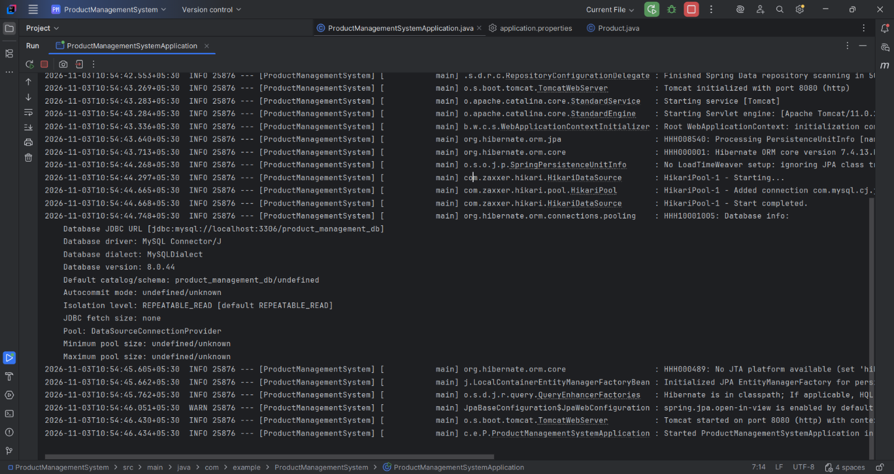
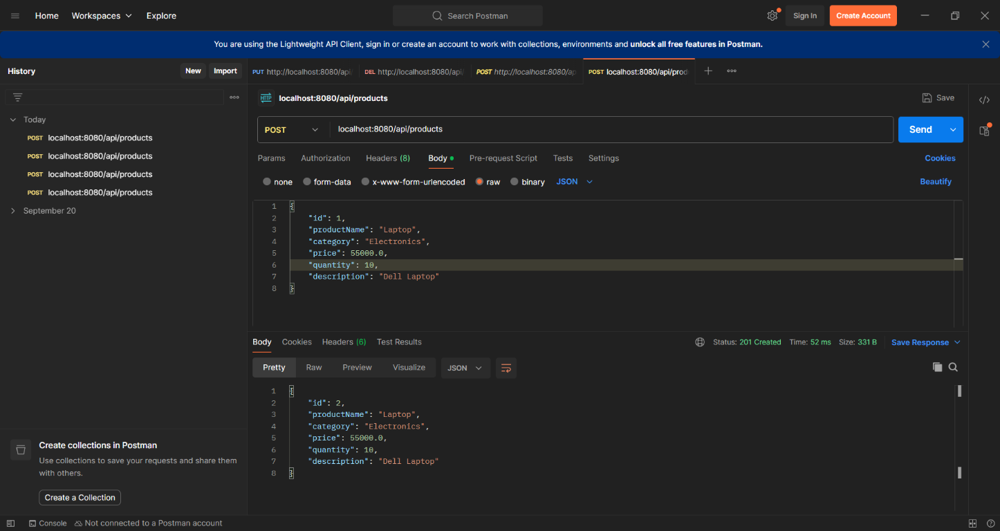
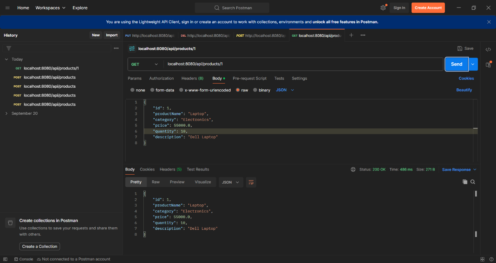
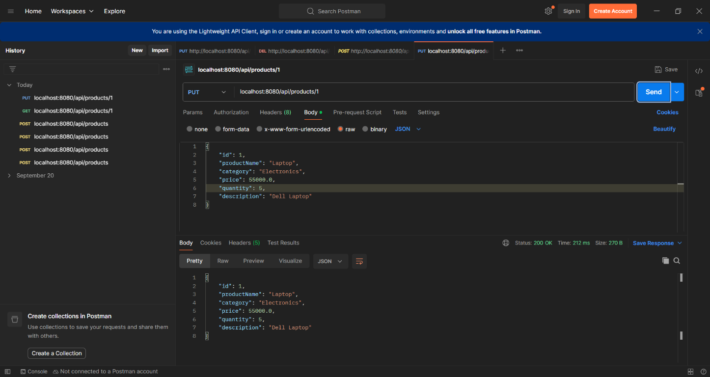
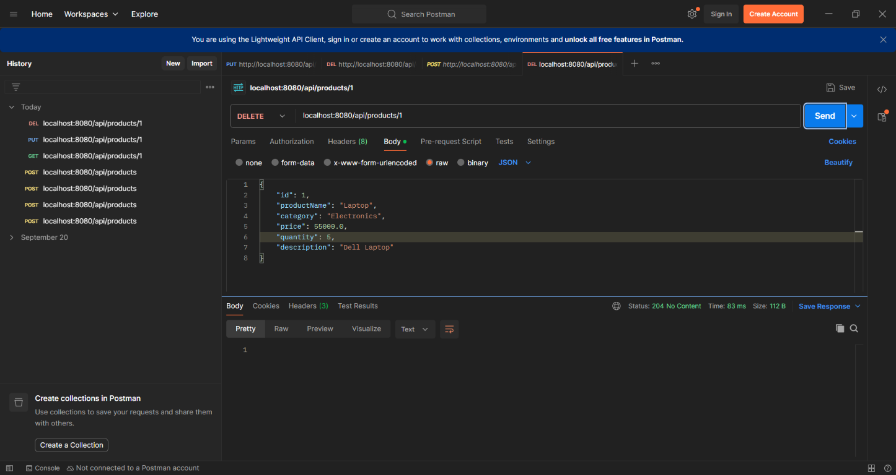

# Product Management System

A simple REST API for managing products. The application is built with Spring Boot and uses MySQL to store product information.

## What the application can do

- Add a product
- View all products or find one by its ID
- Filter products by category
- Update a product
- Delete a product
- Validate product details and return readable error responses

## Requirements

- Java 21
- MySQL

The project includes the Maven Wrapper, so you do not need to install Maven separately.

## Set up the database

1. Start MySQL.
2. Create a database named `product_management_db`.
3. Check `src/main/resources/application.properties` and update the database URL, username, and password to match your local MySQL setup.

Do not put real database passwords in screenshots or in a public copy of this project.

## Run the application

Open a terminal in the project folder (the folder containing `pom.xml`) and run:

```powershell
.\mvnw.cmd spring-boot:run
```

When Spring Boot reports that the application has started, the API is available at:

```text
http://localhost:8080
```

To stop it, press `Ctrl+C` in the terminal.

> Run the project with Maven, not by compiling `ProductManagementSystemApplication.java` directly with `javac`. Spring Boot dependencies are managed by Maven.

## API endpoints

All endpoints use the `/api/products` path.

| Method | Path | Purpose | Successful response |
|---|---|---|---|
| `GET` | `/api/products` | Get all products | `200 OK` |
| `GET` | `/api/products?category=Electronics` | Filter by category | `200 OK` |
| `GET` | `/api/products/{id}` | Get one product | `200 OK` |
| `POST` | `/api/products` | Create a product | `201 Created` |
| `PUT` | `/api/products/{id}` | Update a product | `200 OK` |
| `DELETE` | `/api/products/{id}` | Delete a product | `204 No Content` |

Example JSON body for creating or updating a product:

```json
{
  "productName": "Laptop",
  "category": "Electronics",
  "price": 55000.0,
  "quantity": 10,
  "description": "Dell Laptop"
}
```

The `productName` and `category` must not be blank. The price must be greater than zero, and quantity must be zero or more. If a request is invalid or a product ID does not exist, the API returns a JSON error response.

You can try the endpoints with Postman. Start the application first, then send requests to `http://localhost:8080/api/products`.

## Automated tests

Run the tests from the project folder:

```powershell
.\mvnw.cmd test
```

The tests use an in-memory H2 database, so MySQL does not need to be running for this command. They check that the application starts and that product creation, listing/filtering, updating, deleting, validation, and not-found handling work.

Maven prints a test summary in the terminal. Detailed reports are written to `target/surefire-reports`.

### Adding a screenshot of the test results

The screenshots below show the application starting and the API being tried in Postman. They are **not** screenshots of the automated test run.

To add an automated-test screenshot:

1. Run `.\mvnw.cmd test` in the terminal.
2. When the run finishes, capture the terminal showing `BUILD SUCCESS` and the test summary.
3. Save the image as `screenshots/automated-tests.png` in this project.
4. Add this Markdown where you want the test screenshot to appear:

   ```markdown
   
   ```

## Screenshots

These screenshots show the application and example API requests made with Postman.

### Application started



### Create a product — `POST /api/products`



### Get a product — `GET /api/products/1`



### Update a product — `PUT /api/products/1`



### Delete a product — `DELETE /api/products/1`


